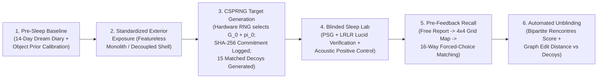

# Project ONEIRIS — Neuro-Cartography, Cross-State Boundary Protocols, and Secondary Dataset Reanalysis

**Scope:** Critical Evaluation & Formalization of **Project ATLAS** (Phase VI), Neurophysiological Protocol for **Project LIMINAL** (Phase VIII), and Real Public Datasets for **Phase IX** Secondary Reanalysis  
**Baseline Reference:** [volume-1-reference.md](file:///C:/Users/Owner/.gemini/antigravity/scratch/project-oneiris/volume-1-reference.md) (Project ONEIRIS Volume I, Hypothesis Frozen at v0.5, 24 November 2026)

---

## Executive Overview

Project ONEIRIS v0.5 separates an **established background claim** (*"Certain neurological states permit immersive conscious experiences that are substantially disconnected from ordinary sensory perception"*) from a **speculative proposition** (*"Some of these states might also permit access to independently existing information"*). Evaluating that proposition requires replacing exploratory prototypes with falsifiable measurement models. This report provides:

1. **ATLAS Critique & Formalization:** Deconstructs the prototype *Dream Reality Index* (construct conflation, arbitrary weighting, non-orthogonality, and lack of chance calibration), replaces it with a three-tier **graph-theoretic and psychometric cartography framework**, and specifies a triple-blinded, cryptographically committed **16-Room Undiscovered Building Protocol** with decoy grammars and exact bipartite/permutation scoring.
2. **LIMINAL Cross-State Neurophysiological Protocol:** Establishes a standardized multi-state comparative pipeline across waking, hypnagogia, REM (lucid vs. non-lucid), NREM (N2/N3 with/without mentation), sleep paralysis, anesthesia (propofol, ketamine), and psychedelic states (DMT) using **evoked alpha power**, **Perturbational Complexity Index ($\text{PCI}$ / $\text{PCI}_{\text{st}}$)**, **Lempel-Ziv Complexity ($\text{LZc}$)**, and **posterior cortical hot-zone** spectral/BOLD markers—anchored by mandatory **Dormio/TMR acoustic positive sensory controls**.
3. **Phase IX Public Dataset Reanalysis Plan:** Identifies **12+ verified, publicly accessible datasets** across the DREAM Consortium, OpenNeuro, NSRR, EBRAINS, DreamBank/Zenodo, Cambridge Apollo, and GitHub, detailing concrete secondary analyses that test ONEIRIS claims *prior to* any new data collection.

---

## Part 1: Project ATLAS — Critique & Formalization

### 1.1 Critical Evaluation of the Prototype Dream Reality Index

In Volume I (Phase VI), the prototype **Dream Reality Index** assigns five 0–100 scores and collapses them into two sub-scores:
- *Spatial consistency:* `70/100`
- *Environmental persistence:* `50/100`
- *Predictable navigation:* `60/100`
- *Independent observer agreement:* `0/100`
- *Verifiable hidden information:* `0/100`
- **Reported aggregate:** *Environmental consistency* = `60%` (mean of first three); *Independent information score* = `0%` (mean of last two).

As a psychometric or cartographic instrument, this prototype fails four foundational validity criteria:

| Defect Category | Specific Failure in Prototype DRI | Methodological Consequence |
| :--- | :--- | :--- |
| **1. Construct Conflation (Ontological Slippage)** | Places *endogenous phenomenological coherence* (items 1–3, reflecting hippocampal-parietal scene construction) inside the same index family ("Dream *Reality* Index") as *exogenous ontological verification* (items 4–5). | High internal spatial coherence ($60\%$–$100\%$) is rhetorically misread as partial "reality" of an independent world, even when independent information = $0\%$. Under Model A (internal simulation), a vivid lucid dream of one's childhood home easily scores $>80\%$ on items 1–3 while carrying zero exogenous information. |
| **2. Arbitrary Weighting & Uncalibrated Scaling** | Computes an unweighted arithmetic mean $\frac{70+50+60}{3} = 60\%$ across ordinal/subjective 0–100 ratings with no anchor definitions, no item-response curves, and no chance baseline. | Treats a 10-point shift in subjective "navigation" as equal to a 10-point shift in "persistence"; ignores base-rate expectations (e.g., ordinary semantic priors make *some* spatial consistency likely by chance). |
| **3. Non-Orthogonality & Structural Collinearity** | Items 1–3 are causally coupled: predictable navigation *presupposes* local spatial consistency and short-term environmental persistence. Similarly, items 4–5 are confounded if two observers share priors or cueing. | Inflates apparent dimensionality (three correlated items counted as three independent lines of evidence) and produces severe multicollinearity in any downstream regression predicting neural state or target hits. |
| **4. Confabulation & Post-Hoc Matching Bias** | Relies on unblinded retrospective dream reports without structured proposition extraction, inter-rater reliability (Krippendorff's $\alpha$), or waking recall controls. | Human spatial memory is reconstructive; during waking report generation, subjects unconsciously "smooth over" topological contradictions (e.g., impossible room adjacencies) to fit waking schemas. |

> **Core Formal Principle:** Endogenous structural coherence ($C_{\text{struct}}$) and exogenous information coupling ($I_{\text{ext}}$) are **mathematically orthogonal axes**. A valid cartography metric must never combine them into a single "Dream Reality" composite.

---

### 1.2 Rigorous Graph-Theoretic & Psychometric Cartography Framework

To formalize dream cartography without ontological assumptions, we model every dream episode $d$ as producing a **directed, edge-labeled spatial-transition graph** extracted from blinded transcript coding (and/or time-stamped lucid eye-signal markers):

$$G_D = (V_D, E_D, \phi_V, \phi_E)$$

where:
- $V_D = \{v_1, \dots, v_n\}$ is the set of distinct reported locales/rooms/zones;
- $E_D \subseteq V_D \times V_D$ is the set of reported traversal transitions $(v_i \to v_j)$ with action labels $a \in \mathcal{A}$ (e.g., *opened north door*, *walked straight*, *teleported/discontinuity*);
- $\phi_V(v_i)$ maps each node to a structured tuple of **sensory/object attributes** and **time-step indices** $\{t_1, t_2, \dots\}$ at each visit;
- $\phi_E(e)$ maps each transition to **reported metric estimates** (distance $\hat{d}_{ij}$, turn angle $\hat{\theta}_{ij}$) and **causal continuity flag** $\kappa_{ij} \in \{0, 1\}$ ($1 =$ continuous traversal, $0 =$ abrupt scene jump/cut).

#### Tier 1: Endogenous Structural Coherence ($C_{\text{struct}}$) — Strictly Internal
Three mathematically distinct, non-redundant graph metrics replace items 1–3 of the prototype:

1. **Metric & Loop-Closure Consistency ($\mathcal{M}_{\text{topo}}$):**
   For every continuous cycle $\gamma = (v_0 \to v_1 \to \dots \to v_k = v_0)$ where $\prod \kappa_e = 1$, compute the normalized Euclidean loop-closure error in $\mathbb{R}^2$ (or $\mathbb{R}^3$) from reported step-vectors $\mathbf{u}_e = (\hat{d}_e \cos \hat{\theta}_e, \hat{d}_e \sin \hat{\theta}_e)$:
   $$\Delta_{\text{loop}}(\gamma) = \frac{\left\| \sum_{e \in \gamma} \mathbf{u}_e \right\|_2}{\sum_{e \in \gamma} \hat{d}_e} \in [0, 1]$$
   Combined with **multidimensional scaling (MDS) Kruskal stress** $\sigma_1(G_D)$ over pairwise reported distances, define:
   $$\mathcal{M}_{\text{topo}}(G_D) = 1 - \frac{1}{2}\left(\overline{\Delta}_{\text{loop}} + \sigma_1(G_D)\right)$$
   *(Note: Purely non-Euclidean jumps $\kappa_{ij}=0$ are tracked separately as a discontinuity rate $\lambda_{\text{cut}} = 1 - \frac{1}{|E_D|}\sum \kappa_e$ so metric distortion inside a continuous scene is not confounded with scene-cuts.)*

2. **Re-Visit & Cross-Night Persistence ($\mathcal{P}_{\text{env}}$):**
   For any node $v$ visited at two distinct times $t_1 < t_2$ (within-dream re-entry or cross-night longitudinal protocol), let $A(v, t)$ be the canonicalized attribute-object set recorded at visit $t$. Define **persistence** via bias-corrected Jaccard similarity penalized by prior predictability:
   $$\mathcal{P}_{\text{env}} = \frac{1}{|V_{\text{revisit}}|} \sum_{v \in V_{\text{revisit}}} \frac{|A(v, t_1) \cap A(v, t_2)|}{|A(v, t_1) \cup A(v, t_2)|} - \mathbb{E}_{\text{prior}}[J(v)]$$
   where $\mathbb{E}_{\text{prior}}[J(v)]$ is the expected attribute overlap from semantic room schemas (e.g., *kitchen* $\to$ *table*) estimated from waking/DreamBank baselines.

3. **Navigational Agency & Transition Predictability ($\mathcal{N}_{\text{pred}}$):**
   Conditioned on **intentional** navigation attempts ($a_{\text{intent}}$, e.g., lucidly attempting to return to a prior room or reach a specified exit), compute the **expected-outcome match rate** and **normalized path efficiency**:
   $$\mathcal{N}_{\text{pred}} = \frac{1}{|E_{\text{intent}}|} \sum_{e \in E_{\text{intent}}} \mathbb{I}[\text{outcome}(e) = \text{intended}(e)] \cdot \frac{d_{\text{shortest}}(G_D)}{d_{\text{traversed}}(e)}$$
   In non-lucid dreams where $E_{\text{intent}} = \emptyset$, $\mathcal{N}_{\text{pred}}$ is explicitly marked **`NA`** rather than scored `0` or averaged in—eliminating a major missing-data conflation in the prototype.

#### Tier 2: Psychometric Measurement & Confabulation Calibration
- **Structured Coding Pipeline:** Independent pairs of coders blinded to target conditions parse raw transcripts into $G_D$ JSON schemas using a standardized codebook. Require inter-rater reliability **Krippendorff's $\alpha \ge 0.80$** on node boundaries, edge continuity $\kappa_e$, and object labels.
- **Latent Factor Verification:** Validate $(\mathcal{M}_{\text{topo}}, \mathcal{P}_{\text{env}}, \mathcal{N}_{\text{pred}})$ via **Confirmatory Factor Analysis (CFA)** and **Item Response Theory (Graded Response Model)** against a **Waking VR Navigation Recall Control** (participants navigate a virtual building while awake, undergo a matched delay/distractor, and produce a free recall + spatial map). This calibrates human memory-decay and verbal-reporting noise ceilings before interpreting dream scores.
- **Confabulation & Demand Index ($\text{CDI}$):** Include post-report forced probe items asking participants to distinguish *vividly perceived* vs. *inferred/filled-in* spatial links, plus waking baseline dream-log priors.

#### Tier 3: Exogenous Information Coupling ($I_{\text{ext}}$) — Strictly Orthogonal
Exogenous coupling is evaluated exclusively by comparing $G_D$ against a cryptographically blinded ground-truth graph $G_0$ (and $D$ matched decoy graphs $\{G_1, \dots, G_D\}$) via:
1. **Conditional Mutual Information:** $\hat{I}(T; R \mid S)$, where $T = (G_0, \pi_0)$ is the hidden target configuration, $R = (G_D, \hat{\pi})$ is the pre-unblinding structured report, and $S$ is the verified neurophysiological state;
2. **Exact Permutation $p$-value and Bayes Factor ($BF_{10}$)** relative to $H_0: I(T; R \mid S) = 0$.

---

### 1.3 Formalized 16-Room Undiscovered Building Protocol

The Volume I prototype (*"computer generates virtual building with 16 rooms, each containing a randomly assigned object; participant sees only exterior, attempts to enter in dream, reports before seeing interior"*) suffers from **four severe vulnerabilities**:
1. **Exterior-to-Interior Structural Leakage:** Standard building exteriors leak room count, symmetry, window grid, and functional layout.
2. **Semantic Room-Object Priors:** If rooms look like bedrooms/kitchens or objects are everyday household items, prior probability $P(\text{object} \mid \text{room})$ is non-uniform.
3. **Fuzzy Post-Hoc Matching:** Free-text dream reports allow subjective "near-miss" matching (e.g., *red lantern* $\approx$ *orange lamp*).
4. **Experimenter & Scoring Bias:** Any staff member who saw the virtual interior can leak cues or bias interviews.

#### Hardened Experimental Architecture

1. **Decoupled Virtual Topology & Grammar ($G_0$ + 15 Decoys):**
   - **Exterior:** Participant views a uniform, featureless virtual exterior (e.g., an opaque $4 \times 4 \times 1$ architectural monolith with a single unmarked front threshold on Floor 1) in VR for 3 minutes. The exterior conveys **zero information** about internal wall partitions, door openings, or object placements.
   - **Interior Grammar:** Using a hardware CSPRNG *after* exterior viewing (or sealed before participant arrival), the server generates a connected planar subgraph $G_0 = (V_0, E_0)$ on a $4 \times 4$ room grid ($|V_0| = 16$ rooms, indexed by coordinates $(x,y) \in \{1..4\}^2$ with randomized internal walls/doorways sampled uniformly from spanning-tree + $k$-extra-edge planar graphs) **and** $D = 999$ structural decoy floorplans $\{G_1, \dots, G_{999}\}$ from the exact same generative distribution.
2. **Orthogonalized 16-Object Stimulus Pool ($\mathcal{O}$):**
   - Construct a fixed, closed pool of $N = 16$ perceptually distinct, high-imageability, non-architectural objects (e.g., *brass sextant, cobalt hourglass, origami crane, obsidian pyramid, silver tuning fork, ...*), pre-normed on DreamBank + participant 14-day baseline logs to verify near-uniform baseline spontaneous dream incidence ($<1\%$ per night) and pairwise cosine similarity $< 0.25$ in CLIP/Word2Vec embedding space.
   - Room-to-object assignment $\pi_0: \{1..16\} \to \mathcal{O}$ is drawn uniformly at random from the $16!$ bijections via CSPRNG. Rooms contain **no furniture or functional labels**—only neutral lighting and the single target object on a central pedestal.
3. **Triple-Blinding & Cryptographic Commitment:**
   - **Server Isolation:** The target tuple $(G_0, \pi_0)$ is generated on an air-gapped or access-controlled server that writes only a cryptographic commitment $C_0 = \text{SHA256}(G_0 \| \pi_0 \| \text{salt})$ to the study log prior to sleep.
   - **Personnel Blinding:** Neither the participant, the sleep technician, the morning interviewer, nor the dream-report coders have access to $(G_0, \pi_0)$ until **after** all reports and forced-choice matrices are time-stamped and locked.
   - **Null / Sham Control Trials (25% of nights, randomized):** No interior $(G_0, \pi_0)$ is generated until *after* morning scoring is locked (isolating temporal/precognitive leakage or subtle system artifacts from simultaneous spatial access).
4. **Memory-Contamination & Recall Protocol:**
   - Upon awakening from verified REM (with LRLR lucid-entry signaling when lucid), an automated/blinded interviewer conducts a **three-stage locked recall** before any feedback:
     - *Stage A (Free Narrative):* Unprompted spatial and object description.
     - *Stage B (Topological Sketch):* Participant marks visited rooms, doors, and path order on an empty $4 \times 4$ grid (producing $G_D$).
     - *Stage C (Closed Forced-Choice):* From the 16-object visual menu $\mathcal{O}$, participant assigns objects (with 0–100 confidence) to each visited room (plus forced-choice completion across remaining rooms if testing global bijection, **scored separately** from visited-only rooms to prevent guessing dilution).
     - *Post-hoc exclusion guard:* Any trial in which the participant reports having seen/discussed the virtual object pool outside protocol, or fails wake-check comprehension, is flagged prior to unblinding.

#### Exact Quantitative Scoring & Statistical Inference

1. **Primary Endpoint 1 — Visited-Room Object Identification (Exact Subset Score):**
   Suppose the participant reports entering $m \le 16$ distinct grid rooms $S \subseteq \{1..16\}$ and selects an object $\hat{\pi}(r) \in \mathcal{O}$ for each $r \in S$ (without replacement if they perceive distinct objects, or with replacement if unconstrained).
   - Define exact hit count: $K_S = \sum_{r \in S} \mathbb{I}[\hat{\pi}(r) = \pi_0(r)]$.
   - Under $H_0$ (independence of $\hat{\pi}$ and $\pi_0$, given uniform random $\pi_0$):
     - If $\hat{\pi}$ assigns $m$ *distinct* objects from $\mathcal{O}$ (injective mapping), $\mathbb{E}[K_S] = \frac{m}{16}$ and exact $p$-value is computed via the matching/hypergeometric-permutation distribution over all $16!$ permutations:
       $$P(K_S \ge k \mid H_0) = \frac{1}{\binom{16}{m} m!} \sum_{j=k}^{m} \binom{m}{j} \cdot \text{exact derangement/fill count}$$
       Specifically, for a full $m = 16$ bijection, $P(K_{16} = k \mid H_0) = \frac{1}{k!} \sum_{i=0}^{16-k} \frac{(-1)^i}{i!}$ (the **Rencontres distribution**, $\mathbb{E}[K_{16}] = 1$, $\text{Var}(K_{16}) = 1$, $P(K_{16} \ge 4) = 0.0189$, $P(K_{16} \ge 5) = 0.00366$).
     - If $\hat{\pi}$ allows repetition across $m$ visited rooms, $K_S \sim \text{Binomial}(m, 1/16)$ ($\mathbb{E}[K_S] = m/16$).
   - **Pre-registered Confidence-Weighted Log-Odds Score:** To prevent post-hoc threshold tuning, compute the proper scoring rule (Brier/log-score) using pre-unblinding confidence probabilities $p_{r,o}$ over $\mathcal{O}$.

2. **Primary Endpoint 2 — Topological Graph Alignment (Decoy-Permutation Test):**
   For the reported visited subgraph $G_D$ (mapped onto grid coordinates via the participant's Stage B entry anchor), compute the **Normalized Edge-F1 Similarity** against $G_0$:
   $$S_{\text{topo}}(G_D, G_0) = \frac{2 \, |E_D^{\text{wall/door}} \cap E_0|}{|E_D^{\text{wall/door}}| + |E_0|_{V_D}}$$
   (i.e., precision and recall of *which walls have doors vs. are solid* along the traversed boundary). Evaluate against the $D = 999$ decoy floorplans:
   $$p_{\text{topo}} = \frac{1 + \sum_{d=1}^{999} \mathbb{I}\left[S_{\text{topo}}(G_D, G_d) \ge S_{\text{topo}}(G_D, G_0)\right]}{1000}$$

3. **Multi-Trial Aggregation & Decision Rule:**
   Across $N$ independent participant-nights (e.g., $N = 100$ lucid-REM entries, yielding $>85\%$ power to detect an effect size of $p_{\text{hit}} = 0.15$ vs. chance $0.0625$ at $\alpha = 0.01$):
   - Aggregate exact $p$-values via Stouffer's $Z$-score weighted by $\sqrt{m_i}$ and compute empirical conditional mutual information $\hat{I}(T; R \mid S_{\text{REM-lucid}})$ in bits with block-bootstrap 95% CIs.
   - **Falsification Criterion:** Reject $H_0$ only if **both** $p_{\text{object, FDR}} < 0.01$ *and* $BF_{10} > 10$ against the sham-trial control and decoy-building permutation null—while confirming $I_{\text{ext}} = 0$ on sham nights to rule out sensory/experimenter leakage.

---

## Part 2: Project LIMINAL — Cross-State Neurophysiological Protocol

### 2.1 Critical Appraisal of the Volume I Gateway Equation

Volume I (Phase IV) proposes the Gateway Equation:
$$G = \alpha (1 - S) C V$$
where $S$ = ordinary sensory dominance, $C$ = conscious awareness, $V$ = capacity for conscious perceptual experience, and $\alpha$ = hypothetical coupling to an independent domain.

**Empirical Clarification:** Because $\alpha$ is empirically unobserved, the measurable physiological term is strictly the **Internal Immersion / Sensory-Disconnected Consciousness Product**:
$$\Phi_{\text{immersion}} = (1 - S) \cdot C \cdot V$$
Conventional neuroscience (Model A) predicts that **vivid internal dreaming, hypnagogia, ketamine dissociation, and DMT visions all occur at high $\Phi_{\text{immersion}}$ while $\alpha = 0$**. Therefore, Project LIMINAL's core experimental mandate is to:
1. Operationalize $(1-S)$, $C$, and $V$ via validated, orthogonal neurophysiological biomarkers across 7 target states;
2. Verify whether states claimed to be "liminal gateways" exhibit **unique boundary signatures** or lie smoothly along continuous arousal/complexity/gating manifolds;
3. Enforce **positive sensory controls** so sensory disconnection $(1-S)$ is measured quantitatively rather than assumed.

---

### 2.2 Multi-State Comparative Design & Operationalized Biomarkers

#### Target State Cohort (Within-Subject Where Safe; Harmonized Between-Subject Where Pharmacological)
1. **Ordinary Waking (Baseline):** Eyes-open task, eyes-closed rest, and immersive VR visual-motor control (benchmarked for $S \approx 1$).
2. **Hypnagogia (Sleep Onset N1):** Tracked via Dormio/PSG micro-arousal & sleep-onset EEG (theta rise, alpha dropout, slow rolling eye movements).
3. **Non-Lucid REM vs. Lucid REM:** Verified via polysomnography (sawtooth waves, theta, rapid eye movements, chin EMG atonia $<10\%$ waking baseline) + **Left-Right-Left-Right (LRLR) ocular signaling** for lucidity verification (Konkoly et al., 2021).
4. **NREM Sleep (N2 & N3 Slow-Wave Sleep):** Serial-awakening paradigm separating **NREM+Experience (dreaming)** from **NREM-No-Experience (unconscious)** within identical sleep stages.
5. **Isolated Sleep Paralysis (ISP):** High-risk/recurrent-ISP clinical-volunteer cohort recorded via ambulatory/lab PSG; characterized by REM-like EMG atonia paired with prominent waking posterior alpha ($\sim 8\text{–}12\text{ Hz}$) intrusion and fronto-limbic theta/beta dissociation (cf. PMC8020694).
6. **Anesthetic Disconnected Consciousness:** Titrated **Propofol** (effect-site target-controlled infusion: wake $\to$ mild sedation $\to$ unresponsiveness with repeated-awakening mentation probes, cf. `ds005620`) vs. sub-anesthetic/dissociative **Ketamine** (preserves vivid internal dream-like mentation despite behavioral unresponsiveness).
7. **Psychedelic State (IV DMT):** Eyes-closed, auditory-attenuated bolus/infusion paradigm (cf. Timmermann et al., 2023, PMC10068756) capturing acute peak intensity (0–15 min) vs. placebo.  
*(Note on NDEs/OBEs: Because Near-Death Experiences cannot be ethically induced in healthy participants, NDE data enter LIMINAL via prospective clinical cardiac-arrest registries such as AWARE II [2023] and mechanistic vestibular/TPJ stimulation comparators [Blanke et al., 2002], rather than acute healthy-volunteer challenge protocols.)*

#### Core Multimodal Biomarker Suite (EEG / MEG / fMRI)

| LIMINAL Parameter | Concrete Neurophysiological Marker | Measurement & Extraction Specification | Expected Cross-State Behavior & Critical Caveats |
| :--- | :--- | :--- | :--- |
| **$(1 - S)$: Sensory Disconnection** | **Evoked Alpha Power ($8\text{–}12\text{ Hz}$)** & Inter-Trial Coherence (ITC) | Auditory/somatosensory stimulus-locked ERSP ($0\text{–}800\text{ ms}$ post-stimulus) over parieto-occipital & central sensors; baseline-corrected ($-500$ to $-100\text{ ms}$). | **Sanders/Casey et al. (2018, PMC6226534):** *Reduced evoked alpha power* robustly indexes **disconnected consciousness** across both NREM/REM sleep and propofol sedation, distinguishing disconnection from mere unresponsiveness or baseline alpha changes. *Crucial distinction:* Evoked alpha power must not be confused with spontaneous resting alpha. |
| **$C$: Capacity for Integrated Consciousness** | **Perturbational Complexity Index ($\text{PCI}$ & $\text{PCI}_{\text{st}}$)** | Single-pulse TMS (biphasic, targeted to premotor/parietal cortex at $100\text{–}120\%$ RMT) + 64+ ch EEG; compute Lempel-Ziv compressibility of significant spatiotemporal sources ($\text{PCI}$) or state-transition recurrence ($\text{PCI}_{\text{st}}$). | High ($\text{PCI} > 0.31$) in wakefulness, REM dreaming, ketamine, and NREM dreaming; collapses ($\text{PCI} < 0.31$) in N3 non-dreaming and deep propofol. **Critical Caveat:** `ds005620` (Bajwa et al.) found $\text{PCI}_{\text{st}}$ *did not* significantly differentiate dreaming vs. non-dreaming within moderate propofol sedation—requiring localized posterior metrics alongside global $\text{PCI}$. |
| **$V$: Representational Richness / Differentiation** | **Spontaneous Lempel-Ziv Complexity ($\text{LZc}$ / $\text{mLZc}$)** | Hilbert-amplitude binarization of band-passed ($1\text{–}45\text{ Hz}$) artifact-free 5–10 s EEG/MEG epochs, normalized by shuffled surrogate entropy. | Elevated in **DMT** (exceeding waking baseline; Timmermann et al., 2023) and **REM** relative to N3 slow-wave sleep and deep propofol. Indexes signal diversity/entropy rather than veridical external tracking. |
| **Dream Content Localization** | **Posterior Cortical Hot Zone Activity** | EEG/MEG source-reconstructed **delta ($1\text{–}4\text{ Hz}$) suppression** + **high-frequency gamma ($25\text{–}50\text{ Hz}$) elevation** in parieto-occipital cortex (precuneus, PCC, lingual/fusiform, TPJ); fMRI BOLD pattern decoding in V1–V3 / HVC. | **Siclari et al. (2017, PMC5462120):** Differentiates dreaming vs. non-dreaming in *both* REM and NREM; specific regional activations (e.g., FFA for faces, PPA/posterior parietal for spatial scenes) track dream phenomenology. |

#### Quantitative State-Space Manifold (Testing Model A vs. Model C)
Every epoch across all 7 states is projected into the 4D neurophysiological vector:
$$\mathbf{z}_t = \left( -\Delta \alpha_{\text{evoked}}, \ \text{PCI}_{\text{st}}, \ \text{LZc}, \ \log \frac{P_{\gamma,\text{post}}}{P_{\delta,\text{post}}} \right)$$
- **Test 1 (Boundary Uniqueness):** Use Gaussian Mixture Modeling / UMAP + cross-validated Linear Discriminant Analysis (LDA) to test whether putative "gateway" states (hypnagogia, lucid REM, sleep paralysis, DMT) occupy discrete isolated attractors or form a continuous interpolation between waking, REM, and pharmacological dissociation.
- **Test 2 (Dissociation of Phenomenology from Information):** Regress ATLAS structural coherence $C_{\text{struct}}$ and exogenous coupling $I_{\text{ext}}$ onto $\mathbf{z}_t$. Under Model A, $\mathbf{z}_t$ strongly predicts $C_{\text{struct}}$ (vividness, spatial complexity) while $I_{\text{ext}} \equiv 0$ across the entire manifold.

---

### 2.3 Positive Sensory Controls (Dormio & Acoustic Incorporation)

A major flaw in parapsychological and altered-state protocols is **uncalibrated sensory gating**: without a positive sensory control, a null result on hidden targets can always be dismissed as *"the state couldn't support perceptual reporting,"* while a positive result might reflect *subconscious physical leakage* (e.g., HVAC hum, researcher whispers, equipment LEDs).

Project LIMINAL mandates a **two-arm acoustic positive control** embedded directly in sleep/hypnagogic/sedation sessions:

1. **Arm A — Hypnagogic Targeted Dream Incubation (Dormio / TDI Protocol; Horowitz et al., 2020):**
   - **Trigger:** Real-time physiological sleep-onset detector (drop in posterior alpha + increase in theta + muscle tone drop / hand-flexion sensor via open-source `openSleep` architecture).
   - **Stimulus:** Pre-recorded neutral semantic prompt (*"Remember to think of [Control Word $W_k$]"*) delivered via calibrated bone-conduction or insert earphones at three randomized Sound Pressure Levels: **Sub-threshold** ($-10\text{ dB}$ SL), **Peri-threshold** ($+5\text{ dB}$ SL), and **Supra-threshold** ($+20\text{ dB}$ SL, capped below awakening threshold).
   - **Outcome Metric:** Blinded semantic/lexical incorporation rate $\rho_{\text{inc}}(\text{SPL})$ in immediate post-N1 reports + concurrent **evoked alpha suppression** and **N1/P2 auditory ERP amplitude**.

2. **Arm B — REM & Sedation Targeted Memory Reactivation (TMR) / Two-Way Dialogue (Konkoly et al., 2021):**
   - **Pre-sleep Pairing:** Participant learns 4 arbitrary sound-concept pairs (e.g., chime $\leftrightarrow$ *mountain*, low pulse $\leftrightarrow$ *ocean*) while awake.
   - **State Delivery:** During verified REM (or propofol sedation), deliver soft acoustic cues (and in lucid REM, simple binary/math acoustic prompts) interleaved with **silent sham epochs** and **ATLAS hidden-target attempts** (where *zero* physical acoustic cues exist for the hidden target).

3. **Calibration Logic (The Sensory Isolation Proof):**
   - **Positive Control Validation:** Supra-threshold cues ($+20\text{ dB}$ SL) must yield statistically significant semantic incorporation ($\rho_{\text{inc}} \gg \rho_{\text{sham}}$) and intact auditory ERP components, proving the participant's brain *can* incorporate, dream about, and recall sensory information in that exact recording session.
   - **Leakage Guard Verification:** By mapping the full psychometric curve $\rho_{\text{inc}}(\text{SPL})$ down to $-10\text{ dB}$ SL (where physical incorporation drops to $\rho_{\text{sham}}$ while evoked alpha power remains maximally suppressed), LIMINAL empirically establishes the **physical sensory attenuation floor** ($< 20\text{ dB}$ SPL ambient room noise in shielded chamber). Any putative ATLAS/THRESHOLD hit is valid *only* when ambient acoustic/EM leakage sits strictly below the calibrated $0\%$-incorporation floor.

---

## Part 3: Phase IX — Real Public Datasets for Secondary Reanalysis

Before collecting a single new trial, **Phase IX (Bullet 4)** of Project ONEIRIS asks: *"What existing experimental datasets could be reanalyzed?"* The following **12 verified, publicly accessible datasets** span every state in LIMINAL and every behavioral claim in ATLAS/ECHO/THRESHOLD, allowing immediate empirical stress-testing of ONEIRIS equations without new data collection.

### 3.1 Master Inventory of Verified Public Datasets

| # | Dataset Name & Citation | Repository & Identifier / URL | Modality & Sample Scope | Access Terms |
| :--- | :--- | :--- | :--- | :--- |
| **1** | **The DREAM (Dream EEG and Mentation) Database** (Wong, Herzog, Andrade et al., *Nat Commun* 2025, 16:7495) | DOI: `10.1038/s41467-025-61945-1` · OSF DOI: `10.31234/OSF.IO/69E43` · Hosted on **Monash Bridges / Figshare** & **Zenodo** (companion code) | **>20 harmonized datasets, >500 participants**, thousands of REM & NREM awakenings with sleep M/EEG + structured dream/mentation reports | Open access (Monash/Figshare & OSF/Zenodo) |
| **2** | **TWC_USA & Donders Real-Time Lucid Dialogue Subsets** (Konkoly, Mallett, Paller 2021; Dresler Lab) | **Figshare** (`TWC_USA` DOI: `10.6084/m9.figshare.22106123`; Donders *Dream Database* on Figshare) | Sleep EEG + EOG LRLR signals + **real-time two-way communication** during lucid REM dreaming (math & yes/no dialogue) | Open access on Figshare (within DREAM ecosystem) |
| **3** | **Propofol Repeated Awakening & Complexity Dataset** (Bajwa, Nilsen, Skukies, Aamodt, Ernst, Storm, & Juel) | **OpenNeuro `ds005620`** (DOI: `10.18112/openneuro.ds005620.v1.0.0`) | High-density EEG + **TMS-EEG** during wakefulness, propofol sedation, and repeated awakenings with **dreaming vs. no-experience** reports; includes $\text{PCI}_{\text{st}}$ & $\text{LZc}$ benchmarks | Open access (BIDS / CC0 or OpenNeuro public) |
| **4** | **Simultaneous EEG & fMRI During Human Sleep** (Penn State Cohort) | **OpenNeuro `ds003768`** | **$N = 33$** healthy adults ($22.1 \pm 3.2$ yrs; 17M/16F); **32-ch MR-EEG + T1w + resting fMRI + 15-min sleep fMRI** pre/post visual-motor task; RPGT-scored stages (`W`, `N1`, `N2`, `N3`) | Open access (BIDS on OpenNeuro) |
| **5** | **Neural Decoding of Visual Imagery During Sleep** (Horikawa et al., *Science* 2013) | **GitHub** ([KamitaniLab/HumanDreamDecoding](https://github.com/KamitaniLab/HumanDreamDecoding)) + Brainliner raw fMRI links (>30 GB) | **fMRI** during sleep onset (N1/N2) paired with immediate awakening visual imagery/object reports + waking visual localizers | Open code on GitHub; raw/preprocessed fMRI via README links |
| **6** | **Human Brain Effects of DMT (EEG-fMRI)** (Timmermann et al., *PNAS* 2023) | **GitHub** ([timmer500/DMT_Imaging](https://github.com/timmer500/DMT_Imaging)) | Simultaneous **EEG-fMRI** processed data, nodal BOLD time series, & analysis scripts comparing IV DMT vs. placebo | Open access on GitHub |
| **7** | **Multimodal Psychedelic & Dissociative OpenNeuro Cohorts** (`DMT-HAR-MED`, `LSD`, `Psilocybin`, `Ketamine`) | **OpenNeuro `ds006644`** (DMT+harmine rsfMRI); **`ds003059`** (Carhart-Harris LSD multimodal MRI); **`ds006072`** (Psilocybin Precision Mapping); **`ds005917`** (NIMH Ketamine) | Resting-state / task **fMRI + structural MRI** (and multimodal EEG in `PsiConnect`) across DMT, LSD, psilocybin, and ketamine | Open access (BIDS on OpenNeuro) |
| **8** | **Cambridge Propofol Sedation EEG Cohort** (Chennu et al., *PLoS Comput Biol* 2016) | **University of Cambridge Data Repository (Apollo)** | **~$20$ healthy adults**, 128/256-ch high-density EEG across baseline wake, mild/moderate propofol sedation, & recovery | Institutional repository (Apollo / paper Data Availability) |
| **9** | **EBRAINS TMS-EEG / Perturbational Complexity Datasets** | **EBRAINS Knowledge Graph** (`https://kg.ebrains.eu/`) | Human preprocessed **TMS-EEG** (*From focal stroke to cortical islands*) + rodent multi-anesthetic PCI (propofol, sevoflurane, ketamine) + official **$\text{PCI}$ / $\text{PCI}_{\text{st}}$** workflows | Research account + EBRAINS Data Use Agreement |
| **10** | **DreamBank Historical Dream Report Corpus** (Schneider & Domhoff) | **Zenodo** ([record/14781401](https://zenodo.org/record/14781401)) + parser ([remrama/krank](https://github.com/remrama/krank)); **Hugging Face** (`DReAMy-lib/DreamBank-dreams-en`, `gustavecortal/DreamBank-annotated`) | **Tens of thousands of English dream reports** with Hall/Van de Castle annotations, demographics, & series metadata | CC BY-NC-SA 4.0 (DreamBank.net / Zenodo) |
| **11** | **NSRR Large-Scale Polysomnography Cohorts (`SHHS` & `MESA Sleep`)** | **National Sleep Research Resource** (`https://sleepdata.org`) | **SHHS:** $>6,400$ subjects (C3/A2, C4/A1 EEG at 125 Hz); **MESA:** $>2,200$ subjects (Fz-Cz, Cz-Oz, C4-M1 EEG at 256 Hz + PPG + 7-day actigraphy); `.edf` + `.xml` staging | Free registration + NSRR Data Use Agreement |
| **12** | **Bitbrain Open Access Sleep (`BOAS`) & `openSleep` (Dormio)** | **OpenNeuro `ds005555`** (`BOAS`); **GitHub** ([tomasero/openSleep](https://github.com/tomasero/openSleep)) | **BOAS:** 128 nights simultaneous clinical PSG + wearable forehead EEG; **openSleep:** open-source Dormio hardware/software for hypnagogic TDI | Open access (`ds005555` on OpenNeuro; `openSleep` on GitHub) |

---

### 3.2 Concrete Secondary Analyses Testing ONEIRIS Claims (Zero New Data Collection)

Each analysis below directly tests a load-bearing claim of Volume I (Phases II–VIII) using the public datasets above:

#### Analysis 1: Stress-Testing LIMINAL's Complexity & Disconnection Markers Within Propofol Sedation (`ds005620` + Cambridge Apollo + EBRAINS)
- **ONEIRIS Claim Tested:** Whether Gateway parameters $C$ ($\text{PCI}_{\text{st}}$, posterior hot-zone activity) and $V$ ($\text{LZc}$) reliably separate *disconnected consciousness (dreaming)* from *unconsciousness* across anesthetic states.
- **Concrete Pipeline:**
  1. In **`ds005620`**, Bajwa et al. already observed that global single-channel $\text{LZc}$ and $\text{PCI}_{\text{st}}$ drop from wake to propofol sedation **without distinguishing dreaming vs. non-dreaming awakenings during sedation**.
  2. **Secondary Test:** Re-analyze the 1-minute pre-awakening resting EEG and TMS-EEG blocks in `ds005620` by restricting spatial ROI to the **Siclari posterior cortical hot zone** (parieto-occipital channels/sources), computing **posterior gamma/delta power ratio**, **multichannel $\text{mLZc}$**, and **TMS-evoked alpha power ($8\text{–}12\text{ Hz}$ ERSP)**.
  3. Cross-validate state-transition boundaries on the **Cambridge Propofol (`Apollo`)** 128/256-ch cohort and **EBRAINS** TMS-EEG workflows.
- **Falsification Payoff:** Determines whether LIMINAL's biomarker set actually possesses within-state sensitivity to dream consciousness during anesthesia—or whether `C` and `V` dissociate under GABAergic sedation, requiring a revision of the Gateway Equation.

#### Analysis 2: Multi-Lab Calibration of the Gateway Product $(1-S)CV$ Across REM & NREM (`DREAM` Database + `NSRR SHHS/MESA`)
- **ONEIRIS Claim Tested:** Whether reduced sensory responsiveness ($1-S$) combined with posterior hot-zone activation ($C, V$) continuously predicts dream presence and phenomenological richness across REM, N1, N2, and N3.
- **Concrete Pipeline:**
  1. Across the **DREAM Database** ($>20$ labs, $>500$ subjects), harmonize pre-awakening EEG epochs ($-30\text{ s}$ to awakening) to compute posterior delta/gamma ratio, frontal-posterior coherence, and $\text{LZc}$ as predictors of (a) binary dream recall vs. no-experience and (b) report word count / perceptual vividness.
  2. Derive normative population distributions (mean, 5th/95th percentiles, age-decay curves) of these exact EEG features across **SHHS ($N > 6,400$)** and **MESA ($N > 2,200$)** to ensure lab-derived LIMINAL thresholds generalize beyond healthy young adults.
- **Falsification Payoff:** Quantifies the exact out-of-sample AUC of neural markers for internal dream generation *without* invoking any external term $\alpha X$.

#### Analysis 3: Cross-State Manifold Geometry — Natural Sleep vs. DMT vs. Propofol vs. Ketamine (`DMT_Imaging` + `ds006644` + `ds003059` + `ds005917` + `ds003768`)
- **ONEIRIS Claim Tested:** Whether DMT ("psychedelic gateway" in LIMINAL) and sleep share a common neurophysiological signature or occupy opposing poles of cortical entropy and sensory gating.
- **Concrete Pipeline:**
  1. Using **`timmer500/DMT_Imaging`** (EEG-fMRI nodal time series) alongside **`ds003768`** (sleep EEG-fMRI, $N=33$) and **`ds005620`** (propofol EEG), compute harmonized **fMRI network integration/segregation**, **DMN–visual cortex coupling**, **alpha-band power collapse**, and **$\text{LZc}$**.
  2. Supplement with fMRI functional connectivity gradients from **`ds006644`** (DMT+harmine), **`ds003059`** (LSD), and **`ds005917`** (Ketamine).
- **Falsification Payoff:** Tests whether DMT achieves maximal $\Phi_{\text{immersion}} = (1-S)CV$ purely via $5\text{-HT}_{2A}$-mediated alpha collapse and entropy amplification—demonstrating that extreme immersive reality phenomenology arises naturally from cortical desynchronization rather than requiring external information channels.

#### Analysis 4: Establishing Empirical Baselines for ATLAS Cartography & ECHO Autonomy (`DreamBank` + `TWC_USA` + `Donders Figshare` + `HumanDreamDecoding`)
- **ONEIRIS Claims Tested:**
  - *ATLAS:* What is the natural baseline rate of spatial consistency, impossible transitions, and object co-occurrence in ordinary dreams?
  - *ECHO:* Can real-time dialogue accuracy and dream-character unpredictability be explained by partitioned endogenous cognition?
  - *THRESHOLD/Decoding:* How much visual-semantic information is already decodable from purely internal neural activity during sleep?
- **Concrete Pipeline:**
  1. **DreamBank NLP Cartography (`zenodo/14781401` + `krank`):** Run LLM/dependency-parser spatial-graph extraction across $10,000+$ DreamBank reports to measure empirical distributions of loop-closure violations, scene-cut rates $\lambda_{\text{cut}}$, and baseline object frequencies $p_{\text{base}}(o)$. This produces the mandatory null prior for the 16-room ATLAS protocol.
  2. **ECHO Partitioned Cognition Test (`TWC_USA` `10.6084/m9.figshare.22106123` + Donders Figshare):** Measure response latency, error rate, and EEG spectral markers (frontal theta/gamma vs. posterior alpha) during real-time REM arithmetic/yes-no dialogue to establish the computational capacity and bottleneck profile of endogenous working memory during REM.
  3. **Internal Decoding Ceiling (`HumanDreamDecoding`):** Re-compute mutual information $\hat{I}(\text{BOLD}_{\text{V1–HVC}}; \text{Dream Report Category})$ during sleep-onset N1/N2 to benchmark how much structured visual information arises purely from endogenous neural replay ($M, E, N$).

#### Analysis 5: Pre-Deployment Validation of Wearable Hypnagogic Positive Controls (`ds005555 BOAS` + `openSleep`)
- **ONEIRIS Claim Tested:** Operational feasibility of automated N1 sleep-onset detection for Dormio-style acoustic positive controls in home/low-burden ATLAS trials.
- **Concrete Pipeline:**
  1. Benchmark forehead-EEG sleep-onset (Wake $\to$ N1 $\to$ N2) classification algorithms against gold-standard clinical PSG across all **128 nights of OpenNeuro `ds005555` (BOAS)**, quantifying false-positive trigger rates (delivering cues while still awake—a fatal sensory-leakage confound!) and latency jitter before integrating with `tomasero/openSleep` hardware.

---

## Summary of Deliverables & Methodological Recommendations

1. **Retire the Prototype Dream Reality Index:** Replace the unweighted 5-item average with three strictly separated tiers: **Endogenous Structural Coherence** ($\mathcal{M}_{\text{topo}}, \mathcal{P}_{\text{env}}, \mathcal{N}_{\text{pred}}$), **Psychometric Confabulation Calibration** (CFA/IRT + waking VR recall controls), and **Exogenous Coupling** ($I(T; R \mid S)$).
2. **Harden the 16-Room Building Experiment:** Require decoupled featureless exteriors, CSPRNG planar floorplans + 999 matched decoys, cryptographic commitment prior to sleep, orthogonalized 16-object pools normed on DreamBank, and exact Rencontres/permutation scoring.
3. **Anchor LIMINAL with Positive Sensory Controls:** Pair evoked alpha power, $\text{PCI}/\text{PCI}_{\text{st}}$, $\text{LZc}$, and posterior hot-zone power with Dormio/TMR acoustic dose-response curves to prove both perceptual capacity and physical sensory isolation.
4. **Execute Phase IX Secondary Analyses First:** All core neurological claims of LIMINAL and baseline priors of ATLAS/ECHO can be tested immediately using **DREAM (`10.1038/s41467-025-61945-1`)**, **OpenNeuro (`ds005620`, `ds003768`, `ds005555`, `ds006644`, `ds003059`, `ds005917`)**, **`DMT_Imaging`**, **`HumanDreamDecoding`**, **EBRAINS**, **NSRR (`SHHS`/`MESA`)**, and **DreamBank (`zenodo/14781401`)**.
